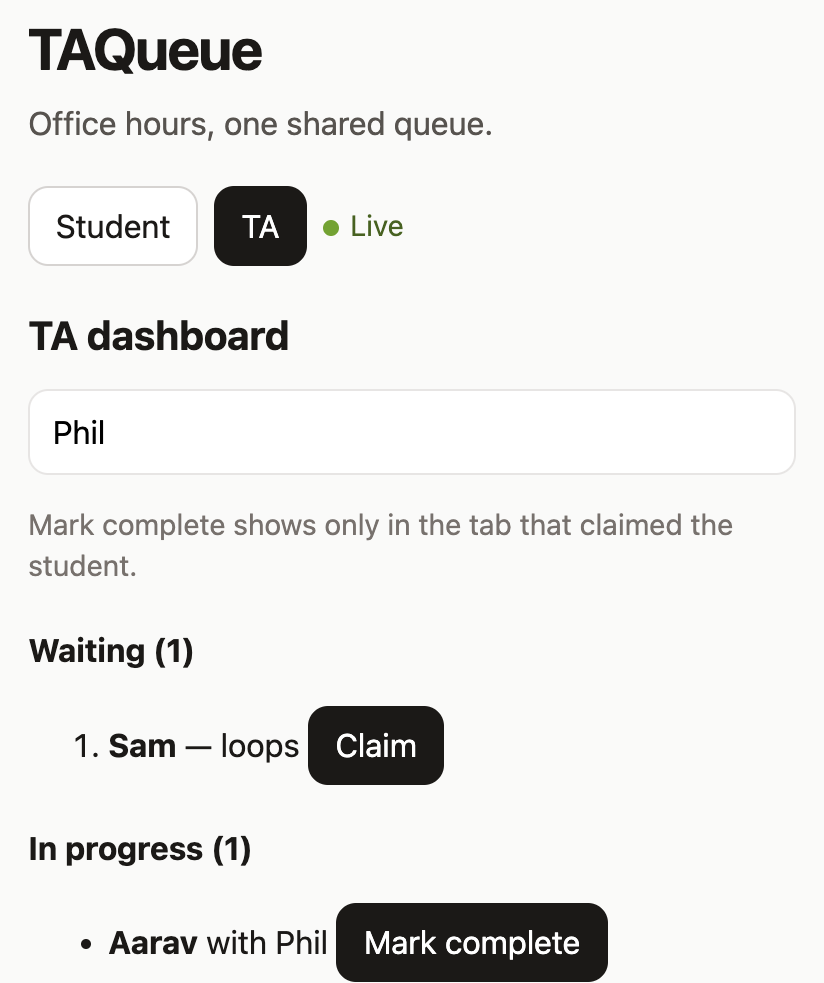

# TAQueue

Students join an office-hours queue and watch their place move up. A TA claims one student, and every open tab updates together. If two TAs claim the same student at the same moment, only one of them gets the student.

**[Open the live demo](https://aarav-kapoor-cs.github.io/TAQueue/)**

The demo runs in the browser, so there is nothing to install. The application in this repository is the full version: a React client, a FastAPI server, and PostgreSQL.



## Try the demo

1. Open the live demo, stay on **Student**, and join with your name.
2. Open the same link in a second tab and switch to **TA**. Type a name and click **Claim**.
3. The first tab updates on its own and says it is your turn. The waiting list in the second tab moves up.
4. **Mark complete** is only on the tab that clicked Claim. The other tab can see the session, and it cannot end it.

**Clear queue** removes the entries in this browser only. Someone else's demo is separate.

## Run the full app

You need Python 3.11+, Node 18+, and PostgreSQL. Docker is the shortest path to the database.

**Database**

```bash
docker compose up -d db
```

Without Docker, on a Mac:

```bash
brew install postgresql@16
brew services start postgresql@16
createdb taqueue
export DATABASE_URL="postgresql://$(whoami)@localhost:5432/taqueue"
```

Keep that `export` in every terminal that runs the backend or the tests.

**API** (terminal 1)

```bash
cd backend
python3 -m venv .venv
source .venv/bin/activate
pip install -r requirements.txt
uvicorn app.main:app --reload --port 8000
```

The table is created on startup. http://localhost:8000/docs lists every endpoint.

**Web app** (terminal 2)

```bash
cd frontend
npm install
npm run dev
```

Open http://localhost:5173. This build talks to the API. The hosted demo is a separate build that keeps the queue in the browser.

**Tests**

```bash
cd backend
source .venv/bin/activate
pytest -v
```

Tests use a separate database, `taqueue_test`, so they do not touch a queue you are demoing.

The whole stack can also be started with `docker compose up --build`. Day to day, start only the database and run the API and web app on your machine.

## What happens when a TA clicks Claim

1. The button calls `claimStudent` in `frontend/src/api.ts`.
2. The browser sends `POST /api/queue/{id}/claim` with the TA's name.
3. The server locks that row with `SELECT … FOR UPDATE` inside a transaction.
4. If the row is still waiting, it is updated and the lock is released. If another TA already took it, the response is `409`.
5. After the commit, the server sends the new queue down every open WebSocket.
6. Each tab replaces its list and React re-renders. Nobody has to refresh.

PostgreSQL is the only copy of the queue. The server does not keep one in memory, so a restart does not lose anyone, and the lock still works if more than one server process is running. The list of open WebSockets is in the memory of one process, so fan-out across many servers would need something like `LISTEN/NOTIFY`.

## API

| Method | Path | Body | Success | Errors | What it does |
|---|---|---|---|---|---|
| POST | `/api/queue` | `{student_name, topic?}` | 201 + entry | 422 | Student joins |
| GET | `/api/queue` | | 200 + list | | Waiting and in-progress students, oldest first |
| GET | `/api/queue/{id}` | | 200 + entry | 404 | One student, including position |
| POST | `/api/queue/{id}/claim` | `{ta_name}` | 200 + entry and `claim_token` | 404, 409 | Claim a student. The token is only in this response |
| POST | `/api/queue/{id}/complete` | `{claim_token}` | 200 | 403, 409 | End the session. The token from claim is required |
| POST | `/api/demo/reset` | | 200 | | Delete every entry |
| WS | `/ws` | | | | Server sends `{type, queue}` on connect and after every change |

```json
{"id": 1, "student_name": "Alice", "topic": "recursion", "status": "waiting", "claimed_by": null, "position": 1}
```

`position` is 1 for the next student. It is `null` once a TA has claimed them. Position is counted when the queue is read, not stored on the row.

## Data

One table, `queue_entries`. A row moves from `waiting` to `claimed` to `completed`.

| Column | Why it is there |
|---|---|
| `id` | Join order. Lower id was earlier. |
| `student_name`, `topic` | Who is waiting, and what they need |
| `status` | `waiting`, `claimed`, or `completed`. The database rejects anything else |
| `claimed_by` | The TA's name. A label, not a password |
| `claim_token` | Random value created at claim time. Returned once. Left out of the public queue |
| `created_at`, `claimed_at`, `completed_at` | Times for each step |

Completed rows stay in the table. The queue query skips them.

## Scope

- One queue. There are no courses, rooms, or accounts. A person picks Student or TA and types a name.
- Ending a session requires the claim token from the tab that claimed it. Typing someone else's name is not enough.
- The browser allows any origin, so a local web app on another port can call the API.

## Tests

`backend/tests/test_queue.py` covers the queue, rejected claims, and who is allowed to finish a session. `test_ten_simultaneous_claims_exactly_one_wins` fires ten claims at one student at the same time and expects a single winner. A second test runs the same claim without the row lock and shows that several TAs can win, so the first test is not passing by accident.

## Layout

```
backend/app/main.py     server: database pool, WebSocket, queue endpoints
backend/app/schema.sql  the one table
backend/tests/          tests, including the concurrent claim
frontend/src/App.tsx    student view and TA view
frontend/src/api.ts     HTTP, WebSocket, and the hosted-demo switch
frontend/src/demoQueue.ts   in-browser queue used only by the live demo
docker-compose.yml      PostgreSQL, or the whole stack
```
